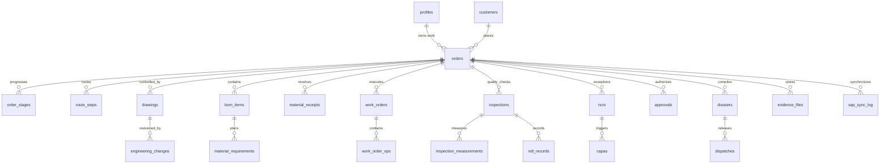
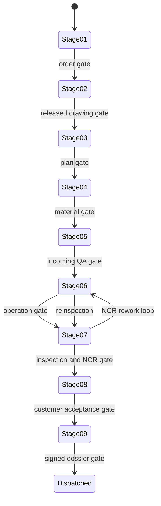

# JSPL Raipur Integrated Workflow Architecture

## Proposed folder structure

```text
/
├── src/
│   ├── components/          # Shared shell and workflow UI
│   ├── pages/               # Routed application modules
│   └── services/            # Supabase and SAP adapter services
├── supabase/
│   ├── migrations/          # Ordered database migrations
│   └── seed.sql             # Deterministic demo data
├── docs/ARCHITECTURE.md
├── package.json
└── .env.example
```

## Data model



## Workflow state machine



## SAP adapter

The frontend uses an adapter interface with a mock implementation backed by Supabase tables. Production mode is a validated integration stub. Adapter calls write outcomes to `sap_sync_log`, expose synchronization status in the UI, and can be retried without bypassing database gates.
